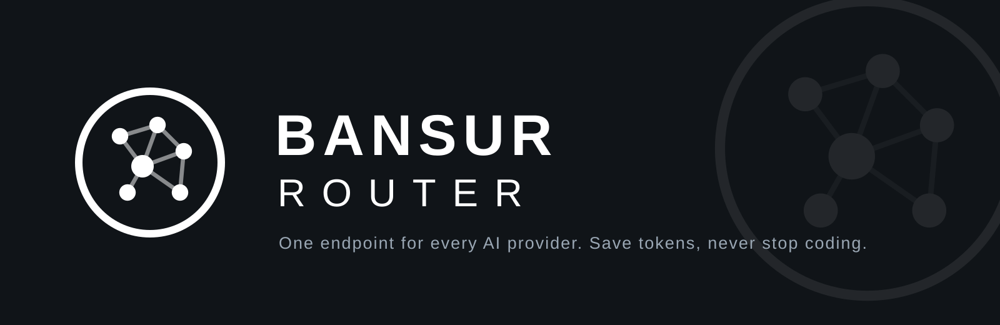

<div align="center">



**One endpoint for every AI provider.**

[](https://www.npmjs.com/package/bansur-router)
[](https://www.npmjs.com/package/bansur-router)
[](https://hub.docker.com/r/bansur/router)
[](https://hub.docker.com/r/bansur/router)
[](https://github.com/mas-ajam/bansur-router/pkgs/container/bansur-router)
[](https://github.com/mas-ajam/bansur-router/blob/main/LICENSE)

[Quick Start](#quick-start) · [Key Features](#key-features) · [Providers](#supported-providers) · [Setup Guide](#setup-guide) · [Documentation](https://bansur-router.pages.dev)

[🇧🇷 Português (Brasil)](./i18n/README.pt-BR.md) • [🇻🇳 Tiếng Việt](./i18n/README.vi.md) • [🇨🇳 中文](./i18n/README.zh-CN.md) • [🇯🇵 日本語](./i18n/README.ja-JP.md) • [🇷🇺 Русский](./i18n/README.ru.md) • [🇹🇭 ไทย](./i18n/README.th.md) • [🇮🇷 فارسی](./i18n/README.fa_IR.md) • [🇮🇩 Indonesia](./i18n/README.id-ID.md) • [🇪🇸 Español](./i18n/README.es.md) • [🇫🇷 Français](./i18n/README.fr.md)

</div>

---

# Bansur Router

Bansur Router is a local AI gateway for coding tools. It runs on your own machine and presents a single OpenAI-compatible endpoint — `http://localhost:667/v1` — in front of every provider you connect to it.

Configure your tool once. From then on, Bansur Router handles the provider connections behind that endpoint: which account answers a request, how the request format is translated, how much quota is left, and what happens when a provider says no. Subscriptions you already pay for are used first, cheaper APIs take over when they run out, and free tiers keep the session alive at the end of the chain.

The dashboard runs at `http://localhost:667/dashboard`, where you connect providers, build model combinations, and watch usage. Keys stay on your machine, traffic is routed locally, and the gateway ships as an npm package and a Docker image built on a Next.js app running on Node.js.

- **One endpoint, one key** — every connected provider, reachable from every tool
- **800+ models** — listed live through `GET /v1/models`
- **3-tier fallback** — Subscription, then Cheap, then Free
- **Token saving built in** — tool outputs are compressed before they reach the model
- **Local-first** — your keys and your traffic stay on your machine

Current release: v1.0.5. Requires Node.js 20.9 or later.

---

## Why Bansur Router

| Problem | What Bansur Router does |
| --- | --- |
| Subscription quota expires unused every month | Tracks quota per account and spends it before it resets |
| A rate limit stops you in the middle of a coding session | Falls back automatically: Subscription → Cheap → Free |
| Tool outputs such as `git diff`, `grep`, and `ls` burn tokens | Compresses tool results with RTK, saving 20–40% of tokens per request |
| Every provider wants $20–50 per month | Routes work to cheap and free tiers when they are good enough |
| Switching providers by hand, separately for each tool | Gives every tool one endpoint and one key, with multi-account round-robin behind it |

---

## Quick Start

### 1. Install and run

```bash
npm install -g bansur-router
bansur-router
```

The dashboard opens at `http://localhost:667`.

### 2. Connect a provider

Open **Dashboard → Providers → Connect**.

You do not need a paid account to start. Connect **Kiro AI** for a free tier of about 50 credits per month, which includes Claude 4.5, GLM-5, and MiniMax, or connect **OpenCode Free**, which needs no authentication at all. If you already have subscriptions or API keys, connect those instead — or as well.

### 3. Point your tool at Bansur Router

```text
Endpoint: http://localhost:667/v1
API Key:  copy it from the dashboard
Model:    kr/claude-sonnet-4.5
```

That is the whole setup. The tool now reaches every connected provider through the one endpoint, and Bansur Router decides where each request goes.

Other ways to run Bansur Router — Docker and building from source — are covered in the [Setup Guide](#setup-guide).

---

## How It Works

Every request arrives in the format your tool sends, passes through the gateway, and leaves in the format the selected provider expects.

```text
Your CLI tool
  Claude Code, Codex, Cursor, Cline, ...
        |
        |  http://localhost:667/v1
        v
Bansur Router
  - RTK token saver (compress tool results)
  - Format translation (OpenAI <-> Claude <-> Gemini)
  - Quota tracking per account
  - Automatic OAuth token refresh
        |
        +--> Tier 1: SUBSCRIPTION
        |    Claude Code, Codex, GitHub Copilot
        |    (used first, while quota lasts)
        |
        +--> Tier 2: CHEAP
        |    GLM ($0.6 / 1M tokens), MiniMax ($0.20 / 1M tokens)
        |    (takes over when subscription quota runs out)
        |
        +--> Tier 3: FREE
             Kiro, OpenCode Free, Vertex AI ($300 credits
             for new Google Cloud accounts)
             (keeps the session running at no cost)
```

Fallback is automatic. When the active tier returns a quota error or a rate limit, the request moves down the chain instead of failing in your editor.

---

## Key Features

| Feature | What it does |
| --- | --- |
| RTK Token Saver | Compresses tool outputs — `git diff`, `grep`, `ls`, and similar results — before they are sent to the model, saving 20–40% of tokens per request |
| Headroom Token Saver | Applies additional compression to request context, further reducing the tokens a long session consumes |
| Smart 3-Tier Fallback | Routes each request Subscription → Cheap → Free, switching tiers automatically on quota exhaustion or rate limits |
| Real-Time Quota Tracking | Shows live usage and reset timing per account, so subscription quota is spent before it expires instead of after |
| Format Translation | Translates between OpenAI, Claude, and Gemini request formats, so a tool built for one API can use providers built for another |
| Multi-Account Support | Holds several accounts per provider and distributes requests across them with round-robin routing |
| Auto Token Refresh | Refreshes OAuth tokens automatically, so connected providers stay connected without repeated sign-ins |
| Custom Combos | Groups models from different providers and tiers into named combinations you select as a single model in your tool |
| Request Logging | Records requests and responses for inspection, which makes routing and provider problems visible instead of silent |
| Cloud Sync | Synchronizes your configuration across machines, so a second computer starts from the same providers and combos |
| Usage Analytics | Breaks down token usage over time by provider, account, and model |
| Deploy Anywhere | Runs locally, in Docker, or on a VPS, with the same dashboard and endpoint in each case |

---

## Supported CLI Tools

Any tool that accepts a custom OpenAI-compatible endpoint can use Bansur Router. The tools below are supported directly, and most of them can be configured from the dashboard's CLI Tools section instead of by editing configuration files by hand.

- Claude Code
- OpenAI Codex
- Cursor
- Cline
- OpenCode
- Antigravity
- GitHub Copilot
- OpenClaw
- Continue
- RooCode

For each tool, the configuration is the same three values: the endpoint `http://localhost:667/v1`, the API key copied from the dashboard, and the model or combo you want that tool to use.

---

## Supported Providers

Connected providers expose more than 800 models through one endpoint. Call `GET /v1/models` against a running instance for the exact list available to your connections.

### OAuth providers

Connect by signing in from the dashboard. Bansur Router stores the session, refreshes its tokens automatically, and tracks its quota.

- Claude Code
- Codex
- GitHub Copilot
- Antigravity
- Gemini
- iFlow
- Windsurf
- Kiro

### Free providers

No payment is required to use these tiers, which makes them the fastest way to a first working request.

| Provider | What the free tier gives you |
| --- | --- |
| Kiro AI | About 50 credits per month free, including Claude 4.5, GLM-5, and MiniMax |
| OpenCode Free | Access with no authentication |
| Vertex AI | $300 in credits for new Google Cloud accounts |

### API key providers

More than 40 providers connect with an API key, including OpenAI- and Anthropic-style services and a wide range of model hosts. The low-cost options most often used as the second tier are:

| Provider | Price |
| --- | --- |
| GLM | $0.6 per 1M tokens |
| MiniMax | $0.20 per 1M tokens |
| Kimi | $9 per month flat |

### Self-hosted providers

Any endpoint that speaks the OpenAI-compatible format can be connected as a provider, so models you serve yourself sit in the same routing chain — and the same combos — as hosted providers.

---

## API Reference

Bansur Router exposes an OpenAI-compatible API on its local endpoint. Authenticate with the API key shown in the dashboard.

### List models

```text
GET /v1/models
```

Returns every model available across your connected providers — more than 800 models once the common providers are connected.

### Create a chat completion

```text
POST /v1/chat/completions
Authorization: Bearer <dashboard API key>
```

```bash
curl http://localhost:667/v1/chat/completions \
  -H "Authorization: Bearer YOUR_API_KEY" \
  -H "Content-Type: application/json" \
  -d '{
    "model": "kr/claude-sonnet-4.5",
    "messages": [
      { "role": "user", "content": "Explain what this function does." }
    ]
  }'
```

The request and response shapes follow the OpenAI chat completions format. Bansur Router translates them into the native format of whichever provider the routing chain selects.

Key URLs on a default installation:

- Dashboard: `http://localhost:667/dashboard`
- API base: `http://localhost:667/v1`

---

## Setup Guide

### Run with Docker

From a checkout of this repository:

```bash
docker compose up -d
```

Published images are available as `bansur/router` on Docker Hub and as `ghcr.io/mas-ajam/bansur-router` on the GitHub Container Registry. The dashboard and API are served on port 667, the same as a local installation.

### Run from source

```bash
cp .env.example .env
npm install
npm run build
PORT=667 HOSTNAME=0.0.0.0 NEXT_PUBLIC_BASE_URL=http://localhost:667 npm run start
```

### Connect a provider

1. Start Bansur Router and open `http://localhost:667/dashboard`.
2. Go to **Providers** and choose **Connect** on the provider you want.
3. For OAuth providers, complete the sign-in in the window that opens. For API key providers, paste the key issued by that provider.
4. Send a request. The provider's quota and usage appear in the dashboard as requests are routed.

Start with a free provider if you only want to verify the setup: Kiro AI or OpenCode Free both work without a paid plan.

### Build a combo

A combo is an ordered list of models treated as one selectable model. Put your subscription model first, a cheap model second, and a free model last, then select the combo in your tool. When the first model is unavailable — quota exhausted, rate limited, or in error — the request moves to the next entry automatically.

### Change the port

Port 667 is the default, not a requirement.

```bash
bansur-router --port 8080
```

The short form `-p` works as well, and the `PORT` environment variable sets the port for source, Docker, and server deployments. If you change the port, update the endpoint in your tools to match, for example `http://localhost:8080/v1`. Separating the port is also the simplest way to run Bansur Router alongside another local service that already occupies 667.

---

## Frequently Asked Questions

### What is Bansur Router?

A local AI gateway for coding tools. It places one OpenAI-compatible endpoint in front of all your AI providers and routes each request to the best available one, so your tools keep a single configuration while providers, accounts, and quotas change behind it.

### Is it free?

Yes. Bansur Router itself is free and open source under the MIT license. What a request costs depends on the provider it is routed to: free tiers such as Kiro AI and OpenCode Free cost nothing, and for the rest you bring your own subscriptions and API keys and pay those providers directly, exactly as you would without the gateway.

### Where does my data live?

On your machine. Bansur Router is local-first: provider keys are stored locally, requests are routed from your own installation, and the gateway's job is to forward them to the provider you selected. There is no separate account to create before the first request.

### Which port does it use?

667 by default, for both the dashboard and the API. Change it with `--port` (or `-p`) when starting the CLI, or with the `PORT` environment variable.

### Which tools does it work with?

Claude Code, OpenAI Codex, Cursor, Cline, OpenCode, Antigravity, GitHub Copilot, OpenClaw, Continue, and RooCode are supported directly. Any other tool that lets you set a custom OpenAI-compatible endpoint and API key can use it with the same three values.

### A note for Windows users

Stop the running Bansur Router instance before updating the global npm package. Windows locks the files of a running installation, so an update attempted while the gateway is still running will fail until the process is stopped.

---

## Troubleshooting

### The port is already in use

Something on your machine is already listening on 667, often an earlier Bansur Router process that is still running. Stop that process, or start on a different port and point your tools at it:

```bash
bansur-router --port 8080
```

### A provider fails to connect

Reconnect it from the dashboard: **Providers → Connect** for that provider, and complete the sign-in or key entry again. A fresh connection replaces the stored session, and automatic token refresh keeps it valid from there.

### Updating fails on Windows

Stop the running instance first, then run the update again. A running installation locks its own program files on Windows, which blocks the global npm package from being replaced.

### Requests fail after changing the port

Your tool is still pointing at the old address. Update its endpoint to the new port — for example `http://localhost:8080/v1` — and confirm the API key is the one shown in the dashboard of the instance now running.

---

## Support

Report bugs and request features through [GitHub Issues](https://github.com/mas-ajam/bansur-router/issues) on the `mas-ajam/bansur-router` repository. Include the version you are running, how Bansur Router was started (npm, Docker, or source), and the relevant request log when a routing problem is involved.

Full documentation is at [bansur-router.pages.dev](https://bansur-router.pages.dev).

---

## License

Bansur Router is released under the [MIT License](./LICENSE).
